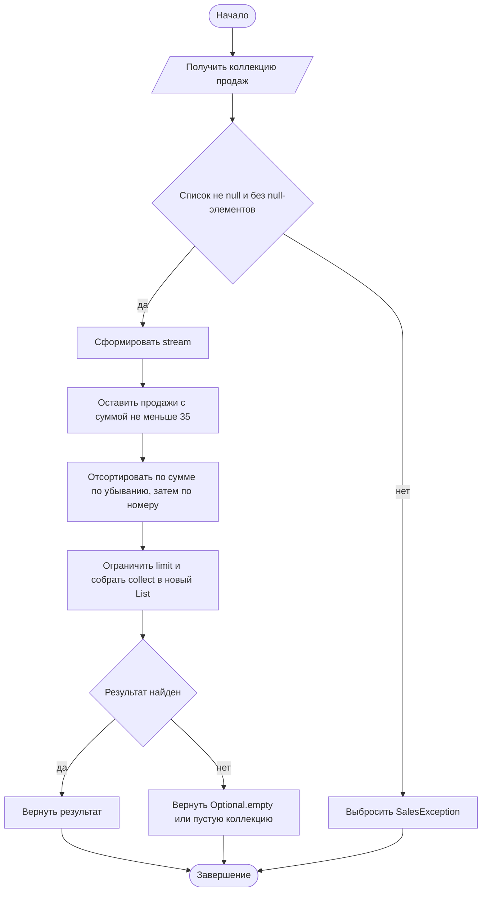
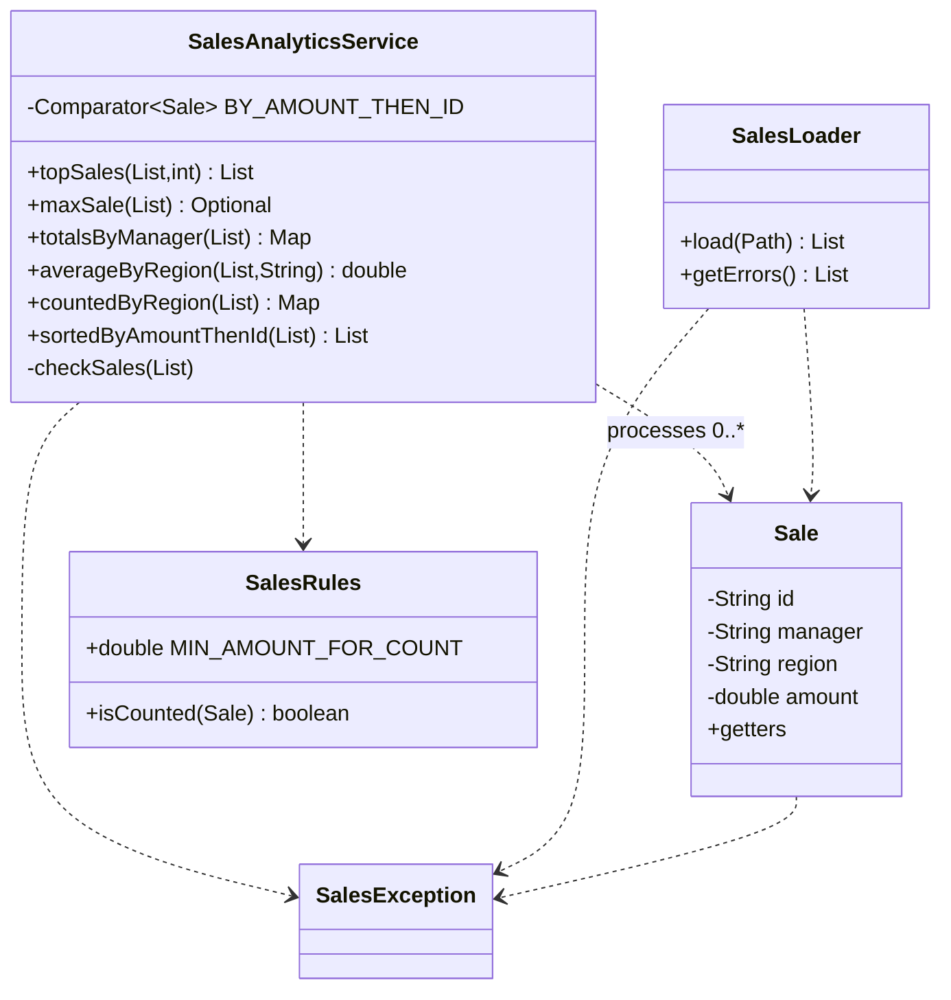

# Практическая работа №12. Stream API, Comparator, Optional

Вариант 6 (две последние цифры зачётки 61: 61 mod 8 = 5, плюс 1 = 6). Изменяемый аспект: дополнительный агрегат, значение 35.

Запуск:

    mkdir out
    javac -encoding UTF-8 -d out src/sales/*.java
    java -cp out sales.SelfCheck
    java -cp out sales.Main data/sample.csv

## Формат файла

Первая строка - заголовок. Далее строки вида `id;manager;region;amount`, разделитель точка с запятой. Сумма может быть с запятой или точкой. Пустые строки пропускаются, но в нумерации учитываются.

## Структура

- Sale - продажа (номер, менеджер, регион, сумма), проверка полей в конструкторе, equals/hashCode по номеру
- SalesException - ошибка данных или параметров
- SalesRules - порог дополнительного агрегата (35) и метод isCounted
- SalesAnalyticsService - topSales, maxSale, totalsByManager, averageByRegion, countedByRegion, sortedByAmountThenId
- SalesLoader - чтение CSV, ошибочные строки собираются, загрузка не падает, повтор номера отклоняется
- SelfCheck - 13 проверок
- Main - сценарий запуска

## Ответы на вопросы задания

**Ошибка во фрагменте.** В коде `sales.stream().filter(this::isLarge).forEach(result::add)` stream наполняет внешний ArrayList result прямо внутри forEach. Это побочный эффект: лямбда меняет объект вне stream, результат зависит от порядка выполнения, и при parallelStream обычный ArrayList может потерять элементы или упасть с исключением. Правило работы запрещает менять внешнюю коллекцию внутри stream. В проекте так сделано через терминальную операцию: `sales.stream().filter(SalesRules::isCounted).sorted(...).collect(Collectors.toList())` в topSales, stream сам создаёт и возвращает новый список.

**Вариант и правило.** Вариант 6, дополнительный агрегат, значение 35. Реализовано так: метод countedByRegion считает количество продаж по каждому региону, учитывая только продажи с суммой не меньше 35. Продажа ровно на 35 учитывается, на 34.99 нет. Результат это новый Map<String, Long> в алфавитном порядке регионов. Порог находится в SalesRules.MIN_AMOUNT_FOR_COUNT.

**Какая проверка защищает от наиболее вероятной ошибки входных данных.** Самая вероятная ошибка это кривая строка в CSV или null вместо списка. Для файла это SalesLoader.parseAmount (пусто или не число) и конструктор Sale (пустой менеджер или регион, сумма не больше нуля или NaN), плохая строка попадает в список ошибок и не ломает остальные. Для сервиса это SalesAnalyticsService.checkSales (null список и null элемент) и проверка пустого региона в averageByRegion.

**Какой метод или класс содержит ключевое бизнес-правило и почему.** Правило про 35 находится в SalesRules.isCounted, потому что это единственное место, где записано число. SalesAnalyticsService отвечает за построение выборок и агрегатов, а не за значения порогов, поэтому менять порог можно без правки логики stream. Правило сортировки (сумма по убыванию, затем номер по возрастанию) записано в одном Comparator BY_AMOUNT_THEN_ID в сервисе и используется в topSales, maxSale и sortedByAmountThenId.

**Как Activity-диаграмма отражает код.** Участок "Сформировать stream - Отфильтровать по условию задачи - Преобразовать или отсортировать - Терминальная операция - Результат найден" это метод topSales: sales.stream(), filter(SalesRules::isCounted) (бывший TODO A1), sorted(BY_AMOUNT_THEN_ID), limit и collect. Ветка "нет" это пустой список на выходе, а в maxSale это Optional.empty.

**Какое изменение требования затронет минимум классов.** Смена порога 35 на другое число: меняется только константа в SalesRules. Сервис, загрузчик и Main используют метод isCounted и числа не знают.

## Сравнение цикла и Stream API

Метод totalsByManager в виде цикла:

    Map<String, Double> totals = new TreeMap<>();
    for (Sale sale : sales) {
        totals.put(sale.getManager(), totals.getOrDefault(sale.getManager(), 0.0) + sale.getAmount());
    }

То же через stream:

    sales.stream().collect(Collectors.groupingBy(Sale::getManager, TreeMap::new, Collectors.summingDouble(Sale::getAmount)));

Для группировки stream короче и сразу показывает, что именно делаем: группируем по менеджеру и суммируем. В цикле приходится вручную доставать старое значение. Для простых проверок вроде checkSales тоже достаточно anyMatch. Если бы в цикле было несколько условий выхода и накопление в нескольких переменных, цикл был бы понятнее, там stream использовать не стоит.

## Граничные проверки (результат SelfCheck)

| Проверка | Результат |
| --- | --- |
| типовой топ-2 | PASS |
| нижняя граница: ровно 35 входит, 34.99 нет | PASS |
| верхняя граница: лимит топа 0, больше размера списка | PASS |
| отрицательный лимит, null список, null элемент | PASS |
| пустой список и пустой регион | PASS |
| maxSale возвращает Optional, пустой список даёт Optional.empty | PASS |
| повтор: равные суммы, побеждает меньший номер | PASS |
| повтор номера продажи в CSV | PASS |
| CSV: пусто, не число, минус, нет менеджера, мало полей | PASS |
| Comparator по двум полям | PASS |
| исходный список и возвращаемые Map не связаны | PASS |

## Activity-диаграмма (обновлённая)

## Диаграмма классов (обновлённая)

